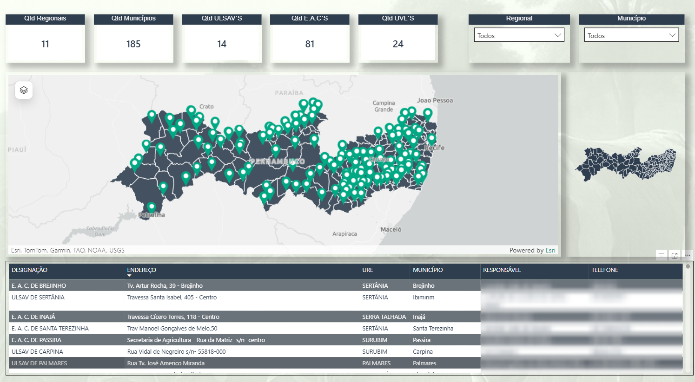
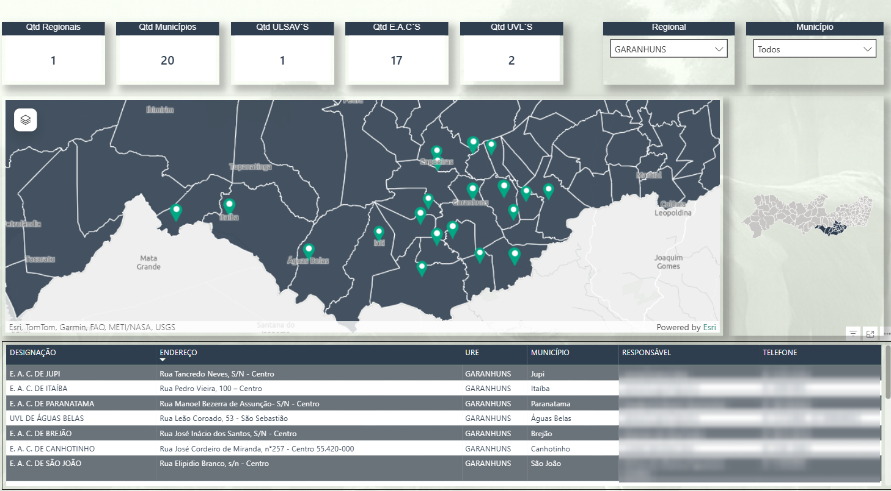
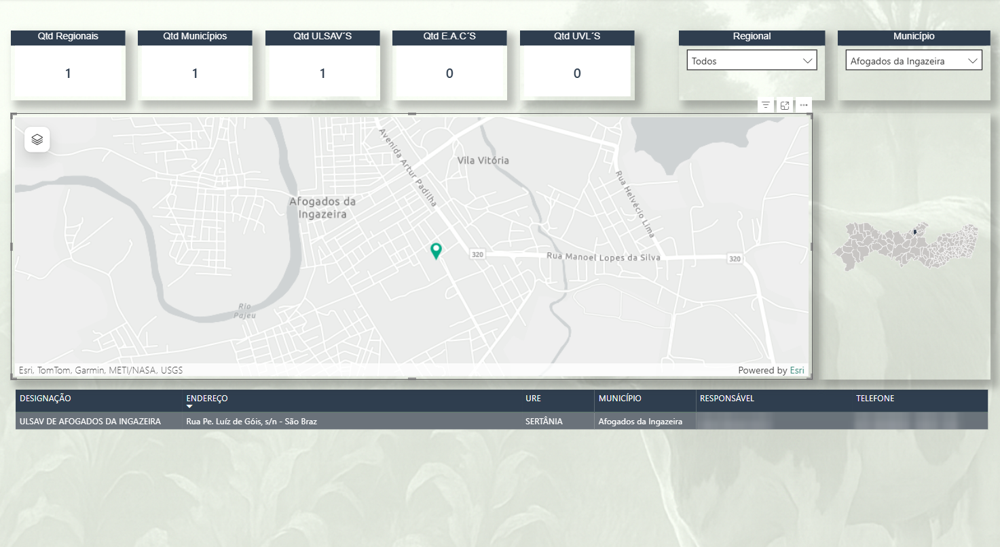

# 🗺️ Mapa de Escritórios da ADAGRO: Power BI

> Painel geoespacial com todas as unidades da ADAGRO em Pernambuco: onde fica cada escritório, quem responde por ele e como fazer contato, filtrável por regional e município.


[](https://github.com/valdanosimao/monitoramento-escritorios-bi/releases/download/v1.0/ESCRITORIOS_ADAGRO.pbix)



---

## 📌 O problema

A ADAGRO tem unidades espalhadas pelo estado (ULSAVs, EACs e UVLs), mas a lista de endereços vivia em planilha. Saber se um município tinha cobertura, quem era o responsável ou qual o telefone de uma unidade exigia procurar linha por linha.

## 💡 A solução

Um painel que transforma a planilha de endereços em mapa interativo:

- **KPIs no topo:** 11 regionais, 185 municípios, 14 ULSAVs, 81 EACs e 24 UVLs.
- **Mapa de pontos (ArcGIS)** com latitude e longitude de cada unidade.
- **Mapa de formas** com a divisão municipal de Pernambuco.
- **Tabela de contato:** designação, endereço, regional (URE), município, responsável e telefone.
- **Filtros cruzados:** escolher uma regional ou município atualiza mapa, KPIs e tabela juntos.

---

## 🛠️ Destaques técnicos

| Desafio | Como resolvi |
|---|---|
| Nomes digitados de jeitos diferentes ("E.A.C.", "EAC ", "eac") | Normalização no DAX com `UPPER`, `TRIM` e `SUBSTITUTE` antes de comparar o prefixo |
| Unidades cadastradas sem endereço inflando a contagem | Filtro `NOT ISBLANK` no endereço |
| Cartões mostrando vazio quando o filtro não tem unidade | `+ 0` no fim da medida para exibir zero |
| Endereço em texto sem coordenadas | Latitude e longitude tratadas no Power Query para o ArcGIS |
| Visão por território | Shape Map com os municípios de PE ao lado do mapa de pontos |

### Medidas DAX

As três medidas seguem o mesmo padrão; muda só o prefixo e o tamanho dele.

```DAX
Qtd EAC =
CALCULATE (
    DISTINCTCOUNT ( 'Municípios'[DESIGNAÇÃO] ),
    FILTER (
        'Municípios',
        LEFT (
            SUBSTITUTE (
                SUBSTITUTE ( UPPER ( TRIM ( 'Municípios'[DESIGNAÇÃO] ) ), ".", "" ),
                " ", ""
            ),
            3
        ) = "EAC"
            && NOT ( ISBLANK ( 'Municípios'[ENDEREÇO] ) )
    )
) + 0
```

```DAX
Qtd ULSAV´S =
CALCULATE (
    DISTINCTCOUNT ( 'Municípios'[DESIGNAÇÃO] ),
    FILTER (
        'Municípios',
        LEFT (
            SUBSTITUTE (
                SUBSTITUTE ( UPPER ( TRIM ( 'Municípios'[DESIGNAÇÃO] ) ), ".", "" ),
                " ", ""
            ),
            5
        ) = "ULSAV"
            && NOT ( ISBLANK ( 'Municípios'[ENDEREÇO] ) )
    )
) + 0
```

```DAX
Qtd UVL =
CALCULATE (
    DISTINCTCOUNT ( 'Municípios'[DESIGNAÇÃO] ),
    FILTER (
        'Municípios',
        LEFT (
            SUBSTITUTE (
                SUBSTITUTE ( UPPER ( TRIM ( 'Municípios'[DESIGNAÇÃO] ) ), ".", "" ),
                " ", ""
            ),
            3
        ) = "UVL"
            && NOT ( ISBLANK ( 'Municípios'[ENDEREÇO] ) )
    )
) + 0
```

---

## 📷 Telas

| Filtro por regional | Filtro por município |
|---|---|
|  |  |

---

## 🧰 Stack

**Power BI** · **ArcGIS Maps** · **Shape Map** · **DAX** · **Power Query (M)**

## 📚 Aprendizados

- Dado cadastrado à mão quase nunca vem padronizado; tratar isso na medida evita contagens erradas sem mexer na fonte.
- Mapa só vale a pena quando responde uma pergunta ("esse município tem unidade?"); por isso a tabela de contato fica colada nele.
- Juntar mapa de pontos e mapa de formas dá a visão de onde há unidade e onde há lacuna de cobertura.

## 🔒 Sobre os dados

Endereços e telefones são das unidades públicas da ADAGRO, informação de atendimento ao cidadão. O arquivo `.pbix` está na [release v1.0](https://github.com/valdanosimao/monitoramento-escritorios-bi/releases/tag/v1.0).

---

👤 **Valdano Simão**, Desenvolvedor Full Stack & IA · [LinkedIn](https://www.linkedin.com/in/valdanosimao) · valdanosimao@gmail.com
